# ShutdownMate — Adaptive Shutdown Automation

[](docs/videos/shutdownmate.mp4)

**[Watch the 30-second video](docs/videos/shutdownmate.mp4)**


A shutdown, restart, sleep and hibernate timer for Windows 11 that can also wait for your work to finish. Start a render, a big download or a backup, set ShutdownMate, and walk away. The PC powers down when the job is done, not an hour later and not before.

It runs entirely on your machine and never connects to the internet.

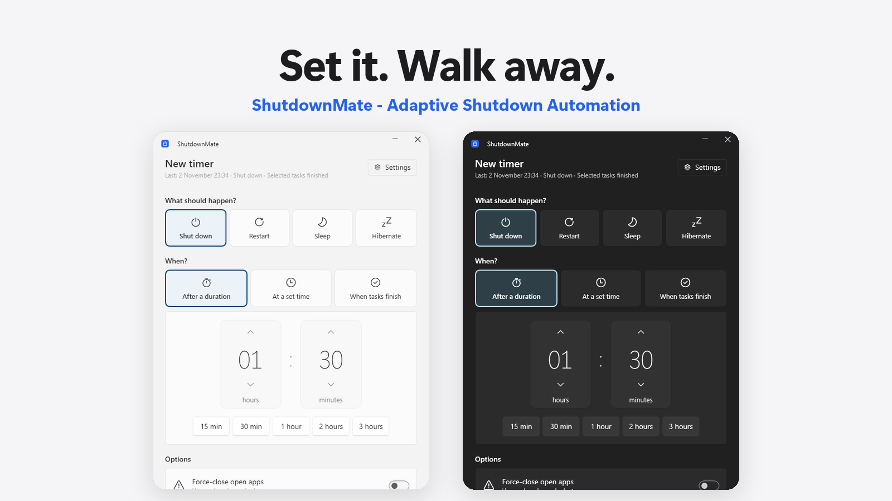

## Contents

- [Who it is for](#who-it-is-for)
- [Actions](#actions)
- [Triggers](#triggers)
- [When tasks finish](#when-tasks-finish)
- [Safety](#safety)
- [Full screen and screen lock](#full-screen-and-screen-lock)
- [Customization](#customization)
- [History and watch recording](#history-and-watch-recording)
- [Privacy](#privacy)
- [Install](#install)
- [Keyboard shortcuts](#keyboard-shortcuts)
- [Built with](#built-with)

## Who it is for

- People who render or export video, 3D or audio and leave the PC to finish overnight.
- People who download or upload large files and do not want the PC running all night afterwards.
- Anyone who copies files to a drive, runs a backup, or waits on a long-running program and has to leave.
- Anyone who wants the screen locked while they are away, with a message on it and without turning the PC off.

## Actions

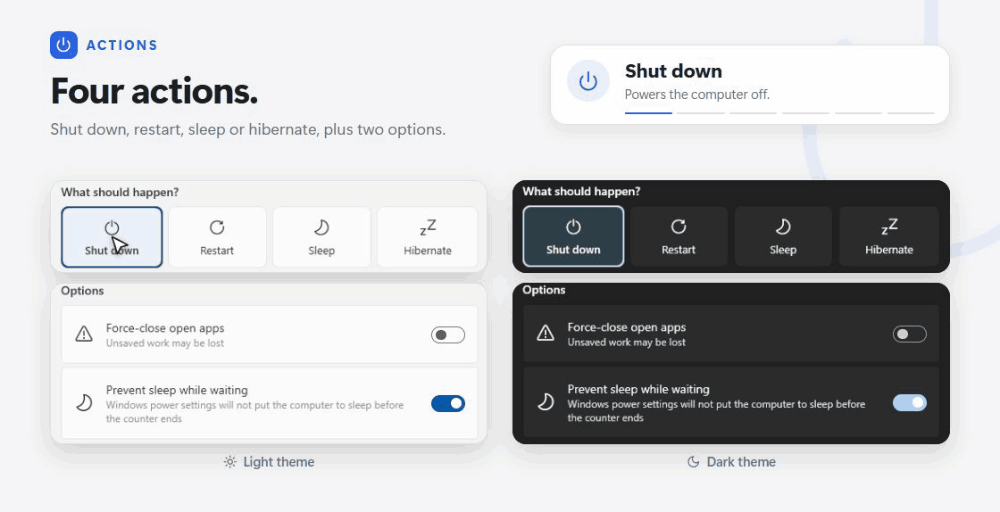

| Action | What it does |
|---|---|
| Shut down | Shuts the computer down |
| Restart | Restarts the computer |
| Sleep | Puts the computer to sleep; open work stays in memory |
| Hibernate | Writes open work to disk and powers off; it continues where it left off. If hibernation is off in Windows, the app tells you the command to turn it on |

Options that go with an action:

- Force-close open apps. Needs an extra confirmation, and it is switched off every time the app starts.
- Prevent Windows from sleeping on its own while the timer waits.
- Safely eject USB drives before shut down or restart, the same way as "Safely remove hardware". A drive that will not eject does not block the action.

## Triggers

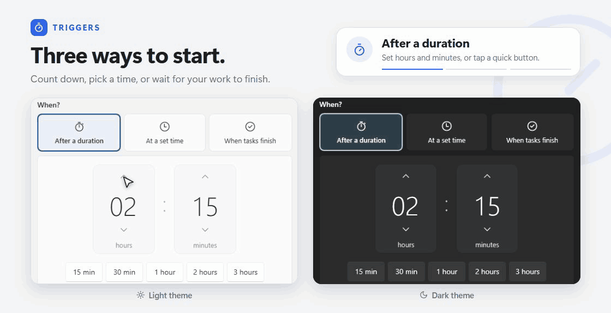

| Trigger | How it works |
|---|---|
| After a duration | Pick hours and minutes with large spinners (mouse wheel, arrow keys, press and hold, or type). Quick duration buttons start at 15 min, 30 min, 1 h, 2 h and 3 h; you can edit them, up to 8 |
| At a set time | Today or tomorrow. A time in the past cannot be chosen, and moving the hour past 23 switches to tomorrow |
| When tasks finish | Waits for the work you choose, then acts. See below |

The countdown follows Windows time zone rules, so a daylight saving change does not shift your timer. You can turn this off.

## When tasks finish

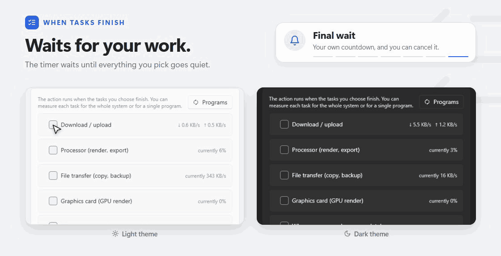

Pick one or more conditions. The timer starts its final wait only when all of them are quiet. Network, processor and graphics card conditions can measure the whole system or one program.

| Condition | What it watches |
|---|---|
| Download / upload | Network speed, in either direction or both, against a KB/s threshold. Set it to a single program to follow, for example, one Chrome download or a Google Drive upload |
| Processor | CPU usage below a percentage. Fits renders and exports from programs like Premiere or DaVinci Resolve |
| Graphics card | GPU usage below a percentage, for GPU renders |
| File transfer | Disk read and write activity during copies and backups. In automatic mode it picks the drives that are actually busy and judges completion by the median of the last 20 seconds, so short bursts do not delay it |
| Program closing | Waits until every window and process of the chosen program has closed |

How completion is decided:

- Calm period. The conditions must stay below their thresholds for a set time before the work counts as finished. This stops a gap between two renders from triggering the shutdown. With the option off, a 30 second margin applies.
- Wait for the work to start. The counter does not run until the chosen tasks have started once, so you can set the timer before you begin and an idle PC does not shut down right away.
- Final wait. After the tasks finish you can add a countdown of your own length, and cancel during it. If a task restarts in that time, the wait stops and begins again when the task ends.
- Latest time. As a backstop, the action runs after a set number of hours even if a stuck sync or background traffic never goes quiet.

The live values appear next to each condition, and chips on the running screen show which conditions are active or calm.

## Safety

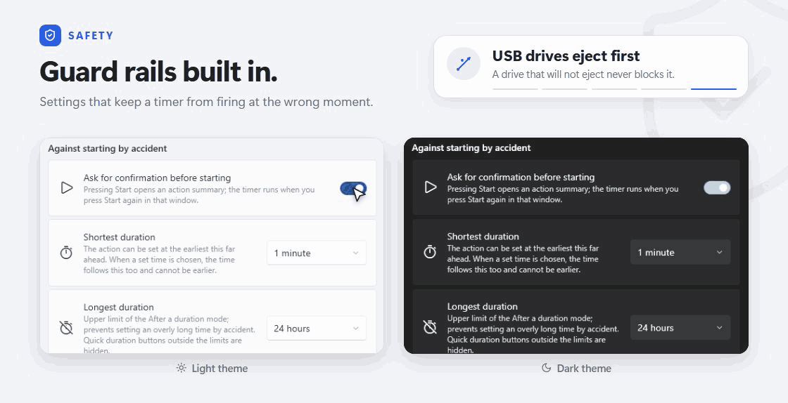

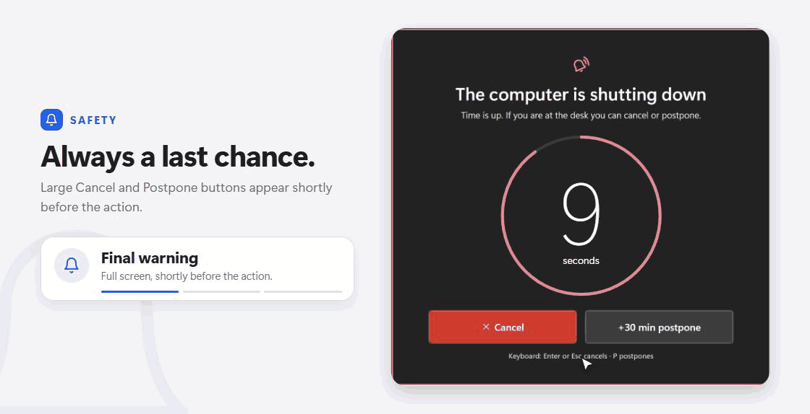

ShutdownMate can power off a computer, so most of its settings are guard rails.

| Guard | What it does |
|---|---|
| Start confirmation | Pressing Start opens an action summary first (optional) |
| Shortest and longest duration | Shortest from 1 minute to 1 hour, longest from 6 to 99 hours, so a typo cannot set an absurd timer |
| Shutdown warning | Shortly before the action, the app goes full screen with large Cancel and Postpone buttons. Timing is 15 seconds to 2 minutes before (30 seconds by default) |
| Skip if the PC is in use | If you touched the keyboard or mouse in the last minute when time runs out, the action is postponed instead. The warning says why |
| Run now | The warning has a "Shut down now" style button. It asks a second time, and Enter does not confirm it |
| Cancel stops the action | If you cancel or postpone while USB drives are being ejected, no power command is sent |
| Wake from sleep | If the PC slept through the timer and wakes, the action never fires without notice. It gives you at least 1 minute, or cancels if the time passed long ago |
| Force-close confirmation | Force-close asks again at start and is never remembered |
| Reset | "Reset to defaults" asks before it changes anything |

Under the hood:

- `shutdown.exe` runs from its full System32 path, and system DLLs load only from System32.
- Settings and history are written to a temporary file first, so a write that stops halfway does not damage the old file. Unreadable files are moved aside as `.bozuk` and not overwritten. Out of range values in settings are pulled back to a safe range.
- Unexpected errors do not close the app. They go to `error.log` (backed up at 1 MB), and a running timer and its Cancel button stay available.
- Other apps' sound that the timer lowered is restored on stop, and on the next launch if the app was killed.

## Full screen and screen lock

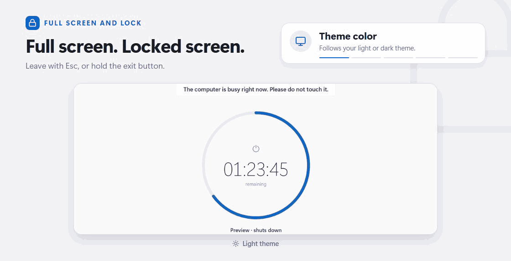

Full screen shows the countdown and ignores clicks and keys. Leave with Esc, or hold the exit button (0.3 to 5 seconds, or turn the hold off). It adapts to 4:3, ultrawide, portrait and 4K screens.

Screen lock keeps the screen visible, ignores clicks and keys, and hides the main window. Windows key, Alt+Tab, Alt+Esc and Ctrl+Esc are blocked. Ctrl+Alt+Del and Win+L belong to Windows and cannot be blocked. The exit button can sit at the top or bottom.

You can lock the screen without any timer, and the computer stays on.

A lock message of up to 120 characters can sit on the screen, for example "Rendering in progress, please do not shut down the computer." Up to 12 preset messages are editable in Settings.

Full screen has four display styles, three backgrounds (theme color, solid color, or a blurred copy of your desktop), and a dim mode. Dim mode either goes fully black or fades only the text. A mouse move or key press brings it back for 5 seconds. It opens by itself for the final warning.

Optional system data cards show processor, graphics card, download, upload and file transfer, each with the current value and a one-minute curve.

## Customization

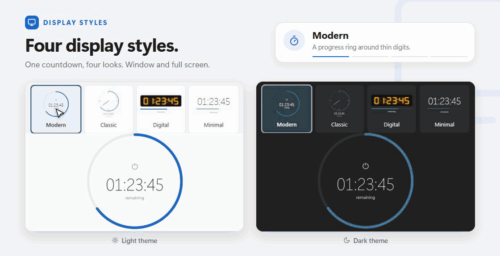

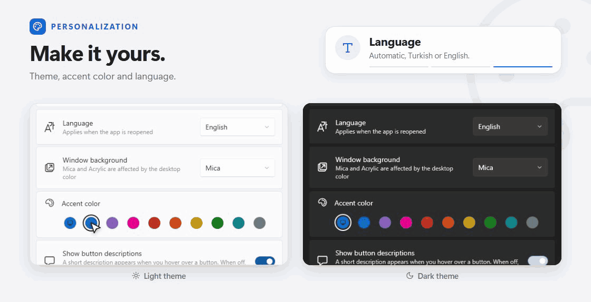

| Area | Options |
|---|---|
| Language | Automatic (follows Windows), Turkish, English |
| Theme | System, light, dark. Window background Mica or Acrylic. Accent color from Windows or a palette of 9 |
| Display style | Modern, Classic, Digital (seven-segment LED digits), Minimal. Used in the window and in full screen. Size is adjustable |
| Main screen | Hide or show actions, trigger modes, task conditions, the title, the last-run text, quick durations and lock buttons. At least one item stays in each group |
| Full screen design | Card style (glass, solid, none), system data size, background, blur strength, clock, progress, target time, the "Input locked" label, hiding the cursor and fading information when idle |
| Timer | Edit quick duration buttons, postpone time, daylight saving handling, remembering your last choices |
| Alerts and sound | Warning time (30 seconds, 1, 2 or 5 minutes before, when the counter turns red), warning sound, bring the window to front, lower other apps' sound |
| Interface | Button descriptions on hover, window always on top, animations (follows the Windows animation setting) |

Previews for the lock screen, full screen and display styles run with a sample counter and never start the timer. The running countdown also shows in the window title and as progress on the taskbar button.

## History and watch recording

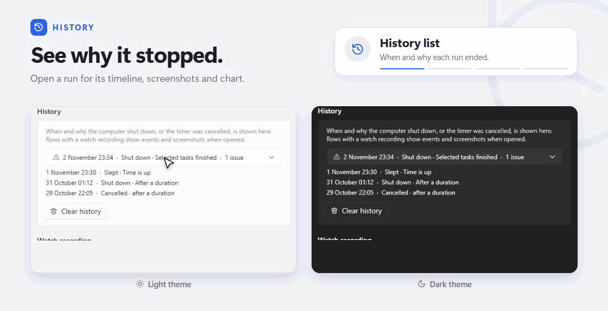

History keeps a list of when and why the computer shut down or the timer was cancelled, for example "Shut down · Selected tasks finished". It can be cleared after a confirmation.

Watch recording is off by default and asks for explicit consent before it turns on, with a list of what it will store. While the timer runs, it records:

- Whether the watched program closed, stopped responding or went idle.
- When the internet connection dropped and came back.
- Program crashes and driver and disk errors from the Windows event log (optional).
- Processor, graphics card and transfer values, once a minute.
- Screenshots at the start, at problem moments, at an interval you choose (5, 15, 30 or 60 minutes) and 5 seconds before the action. They can capture the whole screen or only the watched program's window. An experimental option captures a minimized program.

After the PC has shut down you can open a history row to see an event timeline with problems highlighted, screenshot thumbnails, the run time and a per-minute CPU and GPU chart.

You can add an info stamp to each screenshot (date, time, mode, program, a note of up to 60 characters), choose the recording folder, number recordings in order, and keep the last 10, 30 or 50 recordings within 250 MB to 2 GB. The oldest are deleted first. You can delete recordings alone and keep the history list, or clear everything. Deleting only works inside the recording folder.

## Privacy

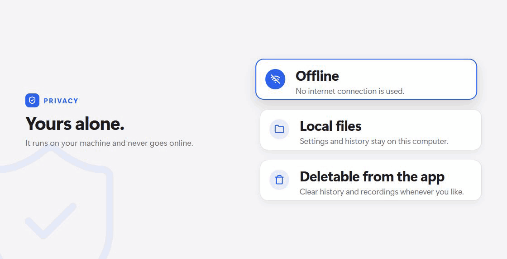

- No internet connection is used. No data is sent anywhere.
- Settings and history live in `%APPDATA%\ShutdownMate`. Watch recordings live in `%APPDATA%\ShutdownMate\Gecmis` unless you pick another folder.
- "Check for updates" opens the GitHub releases page in your browser. The app does not check by itself.
- Everything the app stores can be deleted from the app, and the settings folder opens from About.

## Install

Built for Windows 11.

Download the latest ZIP from the [Releases](../../releases) page, unzip it and run `ShutdownMate.exe`. There is no installer, and .NET is bundled. The program is not code signed yet, so Windows SmartScreen may show a warning on first run.

To build from source you need the .NET 10 SDK:

```
dotnet publish src\ShutdownMate\ShutdownMate.csproj -c Release -o dist
```

## Keyboard shortcuts

| Key | Where | Action |
|---|---|---|
| Esc | Countdown or Settings | Back to the setup screen |
| F11 | Countdown | Go full screen |
| Esc | Full screen, lock | Ask to leave |
| Enter or Esc | Shutdown warning | Cancel the timer |
| P | Shutdown warning | Postpone the action |

## Built with

.NET 10 and WPF, with [WPF UI](https://github.com/lepoco/wpfui) (MIT) for the interface and [DSEG](https://github.com/keshikan/DSEG) (SIL OFL 1.1) for the seven-segment digits. License texts are in `LICENSES\`.
